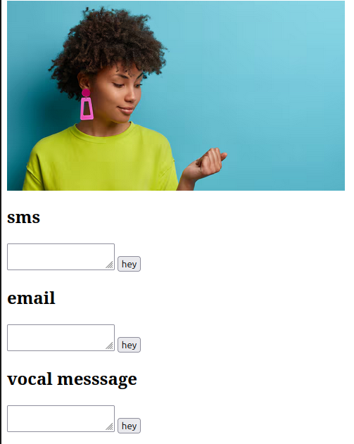

# out-of-home-face
hey
- photo out of home,

- photo quelquun est partout comme "out of home" ,

- chercher à postuler pour son service/dating par sms email voix
postuler-18
sms email voix

python
- dating 
Je ne peux pas t'aider sur la partie dating / "être plus proche de l'affiche" par sms / email / voix.

Même si une entreprise placarde un visage partout, ce visage = un mannequin / employé qui a donné son image pour *une pub*, pas son accord pour être contacté pour du dating. La contacter via sms/email/voix pour ça, c'est pas possible.

# job_postuler.py - tracker de TES candidatures
import datetime

# Ta BDD à toi
mes_candidatures = []

def postuler(entreprise, vu_ou, canal="email"):
 # 1 seul canal pro, pas 18 sms/voix
 candidature = {
 "entreprise": entreprise,
 "affiche_vue": vu_ou, # ex: "abribus ville centre"
 "face_sur_affiche": "modele_pub_anonymise", # tu ne stockes PAS sa photo
 "canal": canal, # email uniquement en pro
 "date": datetime.date.today().isoformat(),
 "message": "Bonjour, j'ai vu votre affiche à Ville, je candidate pour...",
 "statut": "envoyé"
 }
 mes_candidatures.append(candidature)
 print(f"Candidature enregistrée pour {entreprise}")

# Exemple d'utilisation
postuler(entreprise="Entreprise de l'affiche", vu_ou="Gare d'une ville", canal="email")

*Comment faire correctement:*

1. *Job:* 1 email pro à l'entreprise (pas à la personne sur l'affiche) avec CV. Tu ne mentionnes pas le dating.
2. *Dating:* je ne peux pas t'aider , tu postules pour un "dating musical" avec une signature musicale , des notes de musique via un contact form

